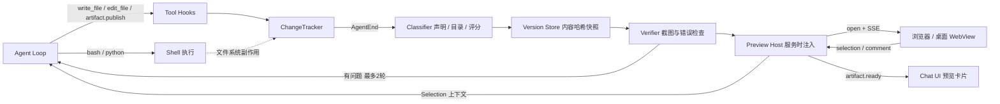
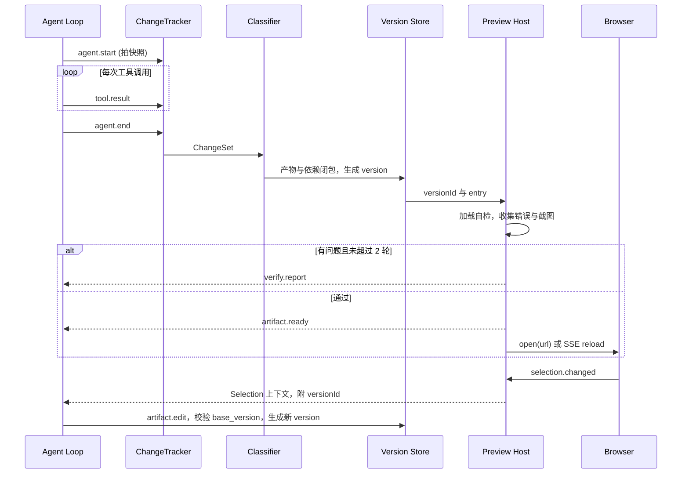

# Agent 产物系统完整设计

从 AgentEnd 自动预览，到产物与临时文件的判定、版本模型、选区改稿、设计系统与画布、交接协作。前半部分是预览链路的协议与代码，后半部分是完整系统的补充设计。

## 目标与难点

目标：一次 Agent 运行结束后，用户不用自己找文件，直接看到最终页面；后续再改，已打开的标签页自动刷新。

- **变更来源有两类**：write_file / edit_file 是工具调用，路径明确；bash / Python 只是执行命令，写了什么文件，工具层完全看不到。
- **产物要自己挑**：一次运行可能产出几十个文件（数据、脚本、图片），只有入口页面值得自动打开。
- **预览要能跑**：直接 `file://` 打开会遇到 ES Module、fetch 的跨域限制，所以走本地 HTTP 服务。

## 总体架构

## 变更检测：钩子加快照，互相兜底

| 通道 | 覆盖范围 | 优点 | 局限 |
| --- | --- | --- | --- |
| 工具钩子 | write_file、edit_file | 精确，能记录 tool_call_id | 看不到 bash / Python 的副作用 |
| 快照 diff（AgentStart 与 AgentEnd） | 所有来源 | 不依赖工具类型，是最终依据 | 只知道结果，需要忽略规则避开大目录 |
| fs watcher（可选） | 运行过程中 | 可以边做边预览 | 事件噪声大，必须防抖 |
| shadow git（可选） | 所有来源 | 自带 diff、回滚，尊重 .gitignore | 初始化和体积成本 |

推荐先做前两种：**钩子负责归因，快照 diff 负责完整性**。以快照结果为准，钩子记录的路径只用来标注“谁改的”。

## 协议与交互时序

### 消息定义（JSON-RPC 2.0）

`declared_entry` 是可选的：让 Agent 通过一个 `artifact.declare` 工具，或写入 `.artifact/manifest.json` 明确指定入口，优先级高于任何猜测。

## 代码实现

### 变更追踪：钩子归因，快照兜底

### 挑选入口产物

### 预览服务：本地、只读、带令牌、支持热刷新

### 挂到 AgentEnd

## 产物还是临时文件：怎么决策

结论：**工具声明是契约，目录约定覆盖 bash / Python，规则评分兜底，Prompt 只负责教模型怎么用。**只靠 Prompt，模型会漏声明、误声明，长会话里还会遗忘；只靠工具，又管不到脚本产生的文件，而且多一次调用就多一次遗漏。

| 层级 | 机制 | 解决什么 | 失效时 |
| --- | --- | --- | --- |
| 1 声明 | `artifact.publish` 工具 | 模型明确表达“这是给用户看的” | 忘了调用，交给第 2、3 层 |
| 2 目录约定 | 产物区 `artifacts/<id>/`，草稿区 `.scratch/` | 对 bash / Python 同样有效，路径即意图 | 写错目录，交给第 3 层 |
| 3 规则评分 | AgentEnd 对未声明文件打分，只生成“候选” | 兜底，不自动打开，降低误报代价 | 误判，交给第 4 层 |
| 4 用户纠正 | 卡片上的“设为产物 / 不是产物” | 最终裁决，并记入本会话偏好 | 无 |

### 规则评分（第 3 层）

| 信号 | 分值 |
| --- | --- |
| 位于 `artifacts/` | +5 |
| 本次运行新建或修改的 html / svg / pdf / md | +2 |
| 位于 `.scratch/`、tmp、node_modules、\_\_pycache\_\_ | −10 |
| 文件名含 tmp、debug、test、out、log | −3 |
| 空文件，或超过阈值的二进制 | −2 |
| 被另一个产物引用（css、js、图片、数据） | 并入该产物，不单独计分 |

总分不低于 3 记为候选产物：**只在卡片里提示，不自动打开浏览器**。已调用 `artifact.publish` 的直接确认，不参与评分。

### 判定规则

- **产物 = 入口 + 依赖闭包。**解析入口 HTML 的 src / href / import，或在预览服务里用请求记录实际被加载的文件，把依赖并入同一个 artifact，不再逐文件判断。
- **生成脚本不是产物**（如 make_chart.py），但记为 provenance（来源），支持“重新生成”。
- **草稿区不进版本快照**，保留 N 天后清理；产物区在每次 AgentEnd 打一个 version。
- **提升**：`artifact.promote` 或 UI 按钮把草稿移入产物区并建立 artifact；反向“降级”同理。
- **同一成果迭代复用同一个 id**，再次 publish 视为新版本，不新建。一次运行允许多个 artifact。

### 工具定义

### Prompt 片段（只教用法，不承担判定）

评估这套机制看三个数：声明召回率（最终产物里有多少是被声明的）、误报率（用户点“不是产物”的比例）、漏检率（用户手动“设为产物”的比例）。

## 桌面端对接与技术选型

| 模块 | 选择 | 理由 |
| --- | --- | --- |
| 桌面壳 | Electron | 自带 Chromium，行为一致，可用 CDP 截图与注入；Tauri 依赖系统 WebView，注入和选择行为差异大 |
| 渲染隔离 | 自定义协议 `artifact://<id>/` + 沙箱 iframe 或独立 WebContentsView + CSP | 每个 artifact 独立 origin，禁止访问宿主 |
| 产物形态 | 先单文件 HTML，再扩展多文件 | JSX 用 esbuild-wasm + import map，无需后端构建 |
| 存储 | SQLite + 内容哈希 | 版本、diff、分支、回滚 |
| 通信 | JSON-RPC 2.0（IPC / WebSocket） | 可参考 MCP 与 ACP 的工具和资源约定 |
| 编辑方式 | str_replace 式 patch | 省 token，可校验，不破坏用户手改内容 |

进程模型：Main 进程持有 Artifact Store 与 Bridge；Renderer 是 Chat UI；Preview 是沙箱 WebContentsView；Agent 作为 sidecar 进程，通过 JSON-RPC 连接 Main。桌面端可以用自定义协议代替本地 HTTP，浏览器预览仍走前文的本地服务。

## 工具协议与选区协议（概览，分层详见后文）

## 选择改稿流程

- **Inspector**：服务时注入，或用 CDP `Page.addScriptToEvaluateOnNewDocument` 注入。capture 阶段监听 mousemove 和 click 并 preventDefault，高亮层放在 Shadow DOM 里，避免污染页面样式。
- **盲区**：canvas 内部、跨域 iframe、closed shadow DOM 选不到，降级为区域框选加截图。
- **批注**：`{anchor: node_id, text}`，支持多条批注一次提交给 Agent。
- **两条修改路径**：颜色、字号、文案这类走确定性 patch，不经过 LLM；布局、风格、重构类建议交给 Agent，按 `source` 定位文件后输出 `artifact.edit`。
- **改后验证**：对 node_id 区域截图回传给 Agent 自检，保持选区高亮，不满意可回滚到上一版本。
- **安全**：选中的页面文本是不可信数据，传给 Agent 时标注为 data，防止页面内容里的 prompt injection。

## 协议分层：Agent Tool、页面协议、钩子、上下文注入

判定规则：**需要模型自己决定何时调用的才是 Agent Tool；用户点界面或到生命周期节点就会发生的是页面协议或钩子；模型每次都该看到的数据直接注入上下文。**write_file、edit_file、bash、Python 是已有工具，不在此列。

| 类别 | 发起方 → 消费方 | 传输 | 进模型 | 条目 |
| --- | --- | --- | --- | --- |
| A Agent Tools | 模型 → Host | MCP 或自有 tools schema | 是，进 tools 列表 | artifact.publish / promote / edit / export / create / read，source.get / find，preview.screenshot / inspect，designsystem.get |
| B 页面协议 | Preview ↔ Host ↔ Client | MessageChannel、IPC | 否 | selection.changed、selection.commit、comment.added、hover、inspector.enable、highlight、apply_ops、edit.result、artifact.ready、export.progress |
| C 生命周期钩子 | Agent runtime → Host | 进程内回调或 JSON-RPC | 否 | onAgentStart、beforeToolCall、onToolResult、onAgentEnd |
| D 上下文注入 | Host → 模型 | 消息块 + 图片 | 是，作为消息 | SelectionPayload、verify.report、设计系统摘要、产物判定 Prompt |

相对前文的三处修正：① `selection.get` 删除，选区由用户点“发送”时推送；② `artifact.create / read` 只在对话模式挂载，文件系统模式用 `artifact.publish / promote`；③ 选区任务激活时，范围守卫同时挂在 `beforeToolCall` 上，不再只校验 `artifact.edit`。

### A. Agent Tool：定义方式

| 工具 | 读写 | 挂载条件 | 关键约束 |
| --- | --- | --- | --- |
| `artifact.publish` | 写 | 文件系统模式 | entry 必须存在且在产物区；同 id 再调即新版本 |
| `artifact.promote` | 写 | 文件系统模式 | from 必须在草稿区；目标 id 不存在则新建 |
| `artifact.create` / `read` | 写 / 读 | 对话模式 | files ≤ 50 个，单文件 ≤ 1MB |
| `artifact.edit` | 写 | 总是 | 必带 base_version；有选区时必带 scope；edits ≤ 50；old_str 唯一匹配 |
| `artifact.export` | 读 | 总是 | 基于 versionId 快照，返回文件路径与 warnings |
| `source.get` / `find` | 读 | 存在选区时 | get 的 context_lines ≤ 20；find 最多 5 条候选 |
| `preview.screenshot` / `inspect` | 读 | 总是 / 存在选区时 | 截图 ≤ 1MB；inspect 的 outer_html ≤ 8KB |
| `designsystem.get` | 读 | Design type | 按组件名或 token 名取，不返回全量 |

| 模式 | 挂载的工具 | 适用 |
| --- | --- | --- |
| 对话模式（无文件系统） | artifact.create / read / edit / export，preview.\* | Web 聊天里的内容直接交给 Host |
| 文件系统模式 | artifact.publish / promote / edit / export，preview.\*；写文件用 write_file、edit_file | 桌面端、CLI Agent |

### B. 页面协议：信封、握手、校验

- 单条消息 ≤ 256KB，截图和裁剪图只传 blob 引用；`hover` 节流到 16ms 一次。
- `apply_ops` 的 `baseVersion` 与当前不一致：丢弃并回 `edit.result`（`ok: false, reason: "conflict"`）。
- 协议只增字段不改字段；收到更高的 `v` 时降级为忽略未知字段，不报错。

### C. 生命周期钩子与守卫

钩子不进模型的 tools schema；`beforeToolCall` 拒绝时，`reason` 作为 tool_result 返回给模型，让它自行改用正确的工具。

### D. 上下文注入：把数据变成消息

- 只有 `<user_instruction>` 里的内容被当作指令；页面文本一律放在 `<selection>` 内并声明为数据，同时在系统提示里写明这条规则。
- 完整 outerHTML、全部样式不注入，需要时由模型调用 `preview.inspect` 或 `source.get` 拉取。
- 设计系统摘要和“产物与临时文件”Prompt 片段放在系统提示的固定前缀，便于 prompt caching。

## 统一数据模型

前面的选区协议和预览链路必须落在同一个模型上。所有事件（预览、选区、回滚、导出）都引用 versionId，文件内容用内容哈希存储，版本只保存 path 到 hash 的映射。

## 选区定位：服务时注入，而不是入库时注入

bash / Python 生成的页面不会经过任何入库钩子，所以 `data-src` 必须在预览服务返回 HTML 时注入：只改发给浏览器的副本，磁盘上的源文件保持干净，Agent 改的也始终是源码。

文件被改动后行号会漂移，因此选区必须带 versionId；版本过期时用 `data-src` 加文本指纹在新版本里重新定位，找不到就提示“选区已失效”。选区脚本与页面同源，页面脚本可能伪造消息，所以 Host 与 Inspector 之间用 MessageChannel 私有端口通信，并校验来源。

## 反馈闭环与流式预览

- **自检闭环**：AgentEnd 后 Host 加载产物（桌面端用 webContents.debugger，也可用 Playwright），收集 console.error、pageerror、失败请求，截取桌面和移动两个视口，并检查横向溢出、空白页、文字对比度。有问题就把 `verify.report` 回灌给 Agent 自动修，最多 2 轮防止死循环，通过后才发 `artifact.ready`。
- **流式渐进**：write_file 的参数流式到达时，每约 300ms 把已到达的前缀交给容错解析（parse5 会补全未闭合标签），用 morphdom 增量更新 iframe；流式阶段先去掉 script，完整后再执行，避免半截 JS 报错。
- **刷新不丢状态**：SSE 收到 reload 时，用 morphdom 或保存并恢复滚动位置，不直接 `location.reload()`。

## 设计系统、画布与直接操作

- **设计系统**：从 CSS 变量、tailwind 配置、组件目录提取出 `design-system.json`（颜色、间距、字体、圆角，以及组件名和用法片段）。给 Agent 的是不超过 2K token 的摘要，细节通过 `designsystem.get(name)` 按需取；生成后做 lint，扫描硬编码颜色和字号，不在 tokens 里的回灌给 Agent。
- **画布**：每个 artboard 一个沙箱 iframe，外层容器用 `transform: translate() scale()` 做平移缩放；选区矩形要换算成 `rect × scale + offset`。变体对比就是同一 artifact 的多个 version 或分支同屏展示。
- **直接操作**：属性面板产生 `setStyle / setText` 之类的 ops，先作用于预览 DOM 得到即时反馈，再按 `data-src` 做确定性 patch 落盘，生成新 version 并进入撤销栈。用户手改与 Agent 改并发时，patch 带 baseVersion，不一致则 rebase 或提示。

## 导出、交接与协作

- **导出**：PDF（printToPDF）、PNG（截图）、PPTX（pptxgenjs，仅幻灯片类产物）、源码 zip。
- **交接包**：`handoff/` 包含源码、design-system.json、选区与批注清单、各 artboard 截图、意图说明 README，通过 CLI 或 MCP 暴露（如 `artifact export --handoff`），也支持把代码库里的设计系统同步进来。
- **协作**（后置）：分享链接分只读、可评论、可编辑三档；评论锚定到 node 和 version；实时共编用 Yjs 同步工作副本。

## 实现补充（代码）

### 产物判定：评分与依赖闭包

### 版本快照与回滚

### 自检闭环

### 快照增强

## Design type 与 Artifact 的关系

共用一个底座，Design 是 Artifact 的一种 type：**可编辑性靠约束换来**。自由 HTML / React 只能事后映射，Design type 在生成阶段约束结构，并在首次产出后做 id stamping。

| 层 | 内容 | 适用 |
| --- | --- | --- |
| 共用底座 | 存储、版本、预览宿主、分享、Agent 工具、选区协议、导出 | 所有 artifact |
| 通用编辑层 | 选区、批注、patch、撤销，可靠性分级（见降级矩阵） | 所有 artifact |
| Type 层 | 结构约定、id stamping、画布与属性面板、设计系统、type 专属指令 | design、slides |

### Design type 结构约束

- 每个画板一个文件：`boards/<boardId>.html`，`boardId` 匹配 `^[a-z0-9-]{1,32}$`。
- 可编辑元素必须有 `data-nid`，格式 `^n_[0-9a-z]{6}$`，同一 artifact 内唯一，删除后的 id 不复用；缺失的由 Host stamping 补齐。
- 颜色、间距、字号走 CSS 变量（tokens），不允许硬编码，lint 不通过则回灌 Agent。
- 画板内的脚本不得增删 DOM 结构，保证选区稳定；需要动态内容时用 `data-dynamic` 标注。
- stamping 生成一个独立 version（`kind: "stamp"`），导出时统一剥离。

## 选择与改稿技术规范

### 操作与协议映射

| 操作 | 触发 | Inspector 行为 | 产出 |
| --- | --- | --- | --- |
| 点选 | click；Shift 追加；Esc 取消 | capture 阶段拦截，语义提升后上报 | `selection.changed` |
| 层级导航 | 面包屑；快捷键选父 / 子 | 沿 DOM 树移动选中点 | `selection.changed` |
| 层叠循环 | Alt+click | `elementsFromPoint` 轮换 | `selection.changed` |
| 框选 | 拖出矩形；Alt 切换相交 / 包含 | 默认完全包含；用 LCA 判断是否成组 | `selection.changed` |
| 批注 pin | 放置锚点并写意见 | 锚点绑定 nid，位置回退为 rect | `comment.added` |
| 文字选区 | 选中文字后点“改写” | 记录 Range 起止与 nid | `selection.changed`，`textRange` |
| 区域标注 | 在截图上画框、箭头 | 无 DOM 时记录 rect 与区域内采样元素 | `regions[]` |
| 浮动输入框 | 选中后出现，含快捷动作 | 收集指令与 intent | `selection.commit` |

语义提升规则：忽略纯布局包装与行内元素；遇到 `data-component`、`button`、`li`、`a`、有背景或内边距的容器即停；提升结果不改变原始命中点，面包屑始终可回退到叶子。框选上限 20，超出拒绝并提示缩小范围。

### 选区结构定义

### Agent 工具与结果码

### 修改落点与 React 规则

| 样式来源 | 落点 |
| --- | --- |
| inline style | 直接改 style |
| class，仅本节点使用 | 改对应规则 |
| class，多处共用（`shared > 1`） | 新增局部 class 覆盖，或询问“只改这个还是全部” |
| Tailwind | 改 class 列表，保持类名顺序 |
| token（CSS 变量） | 优先替换为已有 token，不新增硬编码值 |
| 响应式 | 写入选区 `viewport.w` 对应的媒体查询，除非用户选“所有断点” |

- React 用 Babel / SWC 插件在构建期注入 `data-src="file:line:col"`；落盘用 AST 改写（Babel、ts-morph），不做字符串替换。
- `instances > 1`（map 列表、复用组件）：默认改源码即作用于全部实例，同时提供“仅此实例”，改为改数据或加条件。
- `dynamic: true`：改数据源，不改 JSX 字面量。
- 选中组件调用处还是定义处，要给出“该组件在 N 处使用”。

### 边界与降级

- 状态与瞬时元素：提供 hover / focus 强制开关；选中前冻结动画；弹窗、轮播按当前显示项绑定。
- 主题与断点：选区记录 theme 与视口宽度，深色模式下的颜色同步改 dark 规则。
- 坐标：画布缩放、滚动容器、sticky、transform 统一换算；虚拟列表按数据 key 绑定，不按 DOM 位置。
- 伪元素不可选，通过伪元素面板编辑对应规则。

| 条件 | 能力 | 退路 |
| --- | --- | --- |
| 有 `data-nid`（stamping） | 精确定位，行号漂移无影响 | — |
| 仅 `data-src`（服务时注入） | 精确到文件和行 | 版本过期时用文本指纹重新定位 |
| 无映射 | selector + 文本指纹 | `source.find` 搜源码，结合截图判断 |
| 有 CDP | 精确截图、样式来源、穿透 iframe | 脚本截图，样式只取计算结果 |

## 导出规范：Markdown、HTML、PDF

导出始终基于 **versionId 快照**，不读工作区、不修改 artifact。UI 按钮和 Agent 工具 `artifact.export` 走同一接口。

| 产物类型 | HTML | PDF | Markdown |
| --- | --- | --- | --- |
| html | 单文件，资源内联 | printToPDF | 有损转换，返回 warnings |
| markdown | markdown-it 渲染 + 内置样式 | 经 HTML 渲染 | 原文 |
| react 项目 | esbuild 打包成单文件静态快照，交互不保证 | 渲染后截图式 PDF | 仅文本，返回 warnings |
| slides | 单文件，带翻页 | 每页一个 PDF 页 | 每页用 `---` 分隔 |
| design | 单文件，按画板分节 | 每个画板一页 | UNSUPPORTED，建议导出 PNG 或 PDF |

### 导出约束

- 导出的 HTML 不含 `data-nid`、`data-src` 和 Inspector 脚本；stamp 版本只用于编辑，不作为导出来源之外的内容泄露。
- Markdown 是有损格式，必须返回 `warnings`；图片复制到 `<name>_assets/` 并改成相对路径。
- 文件名为 `<title>-<versionShort>.<ext>`；单个导出文件上限 50MB，超出返回 `TOO_LARGE`。
- PDF 渲染前等待字体和图片加载完成，冻结动画；渲染窗口开启 sandbox，不执行 Node 能力。
- 导出前先通过前文的自检闭环（运行时错误、空白页），失败则在 `warnings` 中说明，不静默输出空文件。

## 成本控制与评测

- **成本**：用 edit 代替整文件重写；选区上下文裁剪（outer_html 不超过 2KB，computed 按需拉取）；设计系统摘要加按需检索；截图用缩略图；系统提示和设计系统作为固定前缀做 prompt caching；自检最多 2 轮。
- **指标**：一次通过率（无运行时错误）、选区解析成功率、产物判定的误报和漏检率、单轮 token 与延迟、用户回滚率。

## 边界与安全

- **访问控制**：只监听 127.0.0.1，随机端口，路径里带随机令牌，并校验 Host 头；服务只读，不执行工作区里的任何代码。
- **路径安全**：先 `realpath` 再比较前缀，挡住 `../` 和符号链接逃逸。
- **内容不可信**：产物是模型生成的页面，建议加 CSP 限制外联；桌面端优先用沙箱化的 WebView 打开，而不是系统浏览器。
- **绝对路径资源**：页面里的 `/style.css` 不会落在令牌前缀下，需要改用 cookie 携带令牌，或注入 `<base href>`。
- **需要构建的项目**（Vite、Next）：不要自动起 dev server，先让用户确认；纯静态产物才自动打开。
- **远程或容器里的 Agent**：服务跑在远端，浏览器访问不到。要么端口转发，要么把变更文件通过协议同步到本机 Preview Host 再起服务。
- **打开策略**：一次运行最多自动打开一个标签页；提供 `autoOpen: always | ask | never` 配置；CI 和无显示环境直接跳过。
- **多次运行入口变化**：入口换了，只推送新的 `artifact.ready` 并在 UI 里提示，不强行跳转用户当前标签页。

## 初版落地顺序（仅预览链路）

1. 快照 diff、入口挑选、`open`：半天可跑通，先解决“结束后能看到”。
2. 本地服务加令牌，SSE 热刷新，解决“再改一次自动更新”。
3. 定义 `artifact.ready`，在 Chat UI 或桌面端展示预览卡片，浏览器自动打开变成可配置项。
4. 补充忽略规则、`artifact.declare` 工具、shadow git 回滚。
5. 远程与沙箱模式，以及 CSP、WebView 隔离加固。

## 分阶段路线（完整方案）

| 阶段 | 内容 | 关键点 |
| --- | --- | --- |
| A 基座 | 产物判定三层、版本快照、AgentEnd 预览与热刷新、运行时错误与截图自检 | 产物区 / 草稿区约定，`artifact.publish`，候选卡片 |
| B 选择改稿 | 点选元素、批注、结构化选区、edit 式 patch | 服务时注入 `data-src`，选区绑定 version |
| C 画布与设计系统 | 多 artboard、变体对比、tokens 约束与 lint、属性面板 | iframe + transform 画布，确定性 patch，撤销栈 |
| D 交接与协作 | 导出、handoff 包、CLI / MCP、分享与共编 | 内容寻址存储，评论锚定，Yjs 后置 |

**对初版代码的修正**：工具钩子记录的路径要统一成相对工作区根的 posix 路径，否则归因会全部落成 shell；预览服务复用时 `artifact.ready` 的 url 要按入口重新生成，不能沿用首次入口；快照只比 mtime 和 size 会漏掉同大小的快速改写，小文件应补 hash，大仓库用 `.gitignore` 或 `git ls-files` 限定范围；绝对路径资源可改用每会话一个子域 `<token>.localhost:port` 解决，Safari 需要实测。